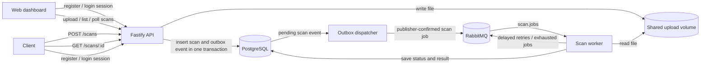

# Mini File Scan Pipeline

Mini File Scan Pipeline is a small portfolio project that demonstrates asynchronous file processing. An HTTP API stores an uploaded file and creates a scan job. A separate worker reads the job from RabbitMQ, checks the file, and saves a result in PostgreSQL.

## Architecture



PostgreSQL stores scan state, result details, and pending outbox events. The file itself stays on a shared local Docker volume, so both API and worker use the same path. RabbitMQ carries only the scan ID, expected SHA-256, and stored file path.

## Build stages

1. **Project skeleton and health:** created the npm workspaces, shared typed configuration, Docker Compose infrastructure for PostgreSQL and RabbitMQ, and `GET /health` dependency checks.
2. **Database and HTTP API:** added SQL migrations, `POST /scans` multipart uploads with SHA-256 hashing and safe stored paths, and `GET /scans/:id` polling.
3. **Scan worker:** added a RabbitMQ consumer that verifies the stored file hash, checks the built-in EICAR signature and configurable blocklist, flags dangerous extensions and oversize files, and saves `Clean` or `Malicious` results.
4. **Reliability:** added a unique SHA-256 index, duplicate-upload reuse, transactional job claims, manual acknowledgements, delayed retries, a dead-letter queue, and graceful worker shutdown.
5. **Tests and CI:** added Jest/ts-jest unit tests and a Docker Compose integration test for upload through completed result, including duplicate upload/message behavior. GitHub Actions runs lint, build, coverage, and integration checks.
6. **Documentation and full local stack:** documented the architecture and design decisions and added API/worker containers so one Compose command starts the complete project.
7. **Transactional outbox:** writes the scan and its publish event in one database transaction, then dispatches pending events with RabbitMQ publisher confirms. The API retries after broker reconnects, and the Compose worker restarts if its broker connection closes.
8. **Outbox retention:** periodically removes published outbox events older than the configured retention window in bounded batches. Unpublished events are never eligible for cleanup.
9. **Authentication and ownership:** adds email/password registration, login/logout, expiring HTTP-only sessions, and per-user scan access. Duplicate uploads are deduplicated per account.
10. **Web dashboard:** adds a responsive browser interface for accounts, file uploads, and recent scan results. The API serves its static assets from the same origin and exposes an owner-scoped scan history endpoint.

## Run the stack

Requirements: Docker with the Docker Compose plugin.

Start PostgreSQL, RabbitMQ, the API, and the worker with one command:

```bash
docker compose up
```

The API listens at `http://localhost:3000`. RabbitMQ management is available at `http://localhost:15672` with the local development credentials `miniscan` / `miniscan`.

The Compose defaults are for local development only. To customize ports, database settings, scanner rules, or retry behavior, copy `.env.example` to `.env` and edit the values. If you change PostgreSQL or RabbitMQ credentials, update the corresponding `COMPOSE_DATABASE_URL` or `COMPOSE_RABBITMQ_URL` as well.

Compose builds service images on the first run. Add `--build` to force a rebuild after changing code.

Stop the containers with `docker compose down`. Named volumes preserve the database and uploaded files. To also delete that local data, run `docker compose down -v`.

## Try the API

Open [http://localhost:3000](http://localhost:3000) for the browser dashboard. Create an account or sign in, choose a file up to 10 MB, and watch its status update automatically. The dashboard uses the same HTTP-only session cookie as the API.

Create an account first. Passwords must be at least 12 characters; the response sets an HTTP-only session cookie:

```bash
curl -i -c cookies.txt -H 'content-type: application/json' -d '{"email":"you@example.com","password":"a-long-passphrase"}' http://localhost:3000/auth/register
```

Upload a file (the API accepts files up to 10 MB):

```bash
curl -b cookies.txt -X POST http://localhost:3000/scans \
  -F "file=@./sample.txt"
```

The API returns `202 Accepted` with a `scanId`. Poll the result:

```bash
curl -b cookies.txt http://localhost:3000/scans/<scanId>
```

List the 50 most recent scans for the signed-in account:

```bash
curl -b cookies.txt http://localhost:3000/scans
```

Possible statuses are `Queued`, `Scanning`, `Clean`, `Malicious`, and `Failed`. Check API, worker, and dependency health with:

```bash
curl http://localhost:3000/health
docker compose logs -f api worker
```

## Design decisions

- **Content-based deduplication:** PostgreSQL enforces a unique SHA-256 per account. A repeated upload returns that user's existing scan ID and does not publish another job.
- **Transactional claim:** the worker locks a scan row and changes `Queued` to `Scanning` in one transaction. A duplicate delivery cannot claim a job already in progress or in a terminal state.
- **Acknowledgements:** the worker acknowledges a completed message only after it saves the result. Failed processing is sent through exponential-delay retry queues; after the configured attempt limit it moves to the dead-letter queue and is marked `Failed`.
- **Transactional outbox:** the scan row and intent to publish are committed together. A dispatcher publishes pending events and marks them complete only after RabbitMQ confirms receipt.
- **Outbox retention:** only confirmed events older than `OUTBOX_RETENTION_DAYS` are deleted, in batches of 500. Pending events remain available for retry.
- **Authentication:** passwords use salted scrypt hashes. Clients receive random opaque session tokens in HTTP-only, SameSite=Strict cookies; PostgreSQL stores only each token's SHA-256 hash. Session lifetime is configured with `AUTH_SESSION_TTL_DAYS`.
- **Scan ownership:** new scans belong to the authenticated user. Both scan polling and hash deduplication are scoped to that user, so accounts cannot see each other's results or reuse each other's scan IDs.
- **Frontend:** the dashboard is plain HTML, CSS, and JavaScript served from the API origin. This keeps cookie authentication simple and avoids a separate frontend service or cross-origin configuration.
- **Filename safety:** client filenames are sanitized for display. Files are stored under generated scan IDs, so client paths never determine storage paths.
- **Scanner scope:** this is a pipeline simulation, not a full antivirus engine. It checks known SHA-256 signatures, filename extensions, file size, and stored-file integrity.
- **Delivery trade-off:** a crash after RabbitMQ confirms a publish but before PostgreSQL marks the outbox row complete can cause a duplicate message. The worker's transactional status claim makes that duplicate harmless.
- **Storage trade-off:** a shared Docker volume keeps local setup simple. A multi-host production deployment would use durable object storage or a shared file service.

## Configuration

Configuration is read from environment variables and validated at startup. `.env.example` lists the available settings. The main scanner and retry settings are:

- `SCAN_BLOCKLIST_SHA256`: comma-separated additional SHA-256 signatures; the EICAR test signature is built in.
- `DANGEROUS_FILE_EXTENSIONS`: comma-separated extensions to flag.
- `SCAN_MAX_FILE_BYTES`: worker-side size limit.
- `SCAN_MAX_ATTEMPTS`: total processing attempts before dead-lettering.
- `SCAN_RETRY_BASE_DELAY_MS`: base delay; each later retry doubles it.
- `OUTBOX_POLL_INTERVAL_MS`: delay between checks when no unpublished event is available.
- `OUTBOX_RETENTION_DAYS`: age after which a published event can be removed; defaults to 30 days.
- `OUTBOX_CLEANUP_INTERVAL_MS`: time between cleanup runs; defaults to one day.
- `AUTH_SESSION_TTL_DAYS`: lifetime for login sessions; defaults to seven days and is limited to 30.

The frontend dashboard refreshes the authenticated user's scan list every four seconds while it is open.

## What I would improve next

- Replace signature and extension checks with a real malware scanning engine in an isolated environment.
- Move uploads to object storage and add retention/deletion policies.
- Add production account controls such as email verification, password reset, login rate limiting, expired-session cleanup, metrics, and multi-worker load tests.
- Add alerts for outbox events that remain pending too long.
